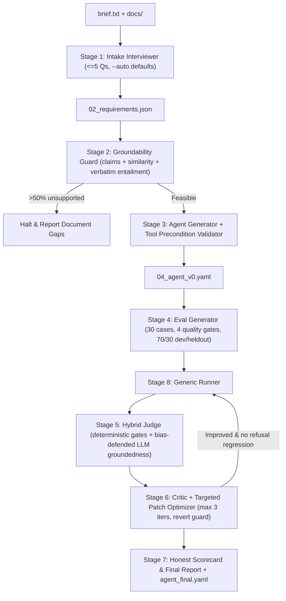

# ForgeAI Architecture & Design Decisions

## Pipeline Overview

## Key Design Decisions
1. **Untrusted LLM Outputs**: Every LLM call in Intake, Guard, Generator, EvalGen, Runner, and Judge passes through Pydantic schema validation with up to 2 JSON repair retries and deterministic cross-checks.
2. **Bias-Defended Judge**:
   - **Self-preference bias**: Judge model (`gemini` / `mistral` / `qwen`) is enforced to use a different model family from the agent (`llama`).
   - **Position bias**: Pointwise case scoring only (no pairwise A/B order bias).
   - **Verbosity bias**: Claim-level verification ignores prose length; longer answers are never rewarded.
   - **Judge hallucination**: Every `YES` claim verdict must include a verbatim supporting sentence verified in `retrieved_context`, or it is deterministically overridden to `NO`.
3. **Re-chunking Safe Retrieval Eval**: `05_eval_set.json` stores `key_facts` and `gold_evidence_texts` alongside `gold_chunk_ids`, so `retrieval_hit` remains valid even when the optimizer modifies `chunk_size` or `chunk_overlap`.
4. **Targeted Patching (No Regeneration)**: Each optimizer step modifies a single dotted field or prompt snippet via `PatchOperation`, accepts only on strict `dev` pass-rate improvement without refusal regression, and logs reverted patches transparently.
